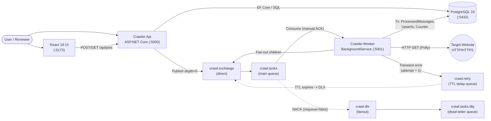

# Web Crawler

## Overview

`web-crawler` is a distributed, job-based web crawler built with .NET 8, RabbitMQ, PostgreSQL, and React 18.
A user submits a target URL and an optional `maxDepth` (0–5, default 2) to the ASP.NET Core Web API (`Crawler.Api`).
The API creates a `CrawlJob` in PostgreSQL, returns a `201 Created` response with `jobId` immediately, and publishes a root `CrawlPageTask` message to RabbitMQ.
A separate background worker service (`Crawler.Worker`) consumes tasks with manual acknowledgements, fetches HTML pages with resilience policies, extracts and normalizes links, computes the per-page **Domain Link Ratio** (`internalLinks / totalValidOutgoingLinks`), persists pages and edges idempotently, and fans out child tasks until `maxDepth` or `maxPages` (default 200) is reached.
A React + TypeScript frontend (or any HTTP client) polls job status and renders the resulting hierarchy of crawled pages as an interactive, cycle-free tree.



---

## Quick Start

### Prerequisites

- **Docker Desktop** (or Docker Engine + Docker Compose v2) — required to run the stack.
- **.NET 8 SDK** *(optional)* — only needed to run `dotnet test` or build locally outside Docker.
- **Node.js 20+** *(optional)* — only needed to run the React dev server (`npm run dev`) outside Docker.

### 1. Start the Backend Stack

From the repository root:

```bash
docker compose up --build -d
```

Wait a few seconds for `postgres`, `rabbitmq`, `api`, and `worker` healthchecks to turn `healthy`:

```bash
docker compose ps
```

### 2. Service URLs & Default Credentials

| Service | URL | Notes / Credentials |
|---|---|---|
| **Crawl API** | `http://localhost:5000` | Base URL for `/api/jobs` endpoints |
| **API Health Probe** | `http://localhost:5000/health` | Liveness + readiness (checks PostgreSQL & RabbitMQ) |
| **Worker Health Probe** | `http://localhost:5001/health` | Worker Kestrel health check (checks PostgreSQL) |
| **RabbitMQ Management UI** | `http://localhost:15672` | Default login: `crawler` / `crawler_pass` |
| **PostgreSQL 16** | `localhost:5432` | DB: `crawlerdb`, User: `crawler`, Pass: `crawler_pass` |
| **React Frontend (optional)** | `http://localhost:5173` | Via Docker profile or local `npm run dev` (see below) |

### 3. Optional: Run the React Frontend

Plain `docker compose up` starts only the backend services (`postgres`, `rabbitmq`, `api`, `worker`) so port `5173` stays free for local development. You can run the UI in either of two ways:

- **Option A — Containerized (nginx):**
  ```bash
  docker compose --profile frontend up --build -d
  ```
  Then open `http://localhost:5173`.

- **Option B — Local Vite Dev Server (requires Node 20+):**
  ```bash
  cd frontend
  npm ci
  npm run dev
  ```
  Then open `http://localhost:5173` (Vite proxies `/api` to `http://127.0.0.1:5000`).

### 4. End-to-End `curl` Example (Create, Poll, Fetch Tree)

```bash
# 1. Create a crawl job (maxDepth=1)
JOB_ID=$(curl -s -X POST http://localhost:5000/api/jobs \
  -H "Content-Type: application/json" \
  -d '{"url":"https://books.toscrape.com","maxDepth":1}' | grep -oE '[0-9a-f-]{36}')
echo "Created Job ID: $JOB_ID"

# 2. Poll job summary until status is Completed
curl -s http://localhost:5000/api/jobs/$JOB_ID

# 3. Fetch the crawled page tree once Completed
curl -s http://localhost:5000/api/jobs/$JOB_ID/tree
```

### 5. Configuring `API_PORT` (macOS AirPlay Conflict on Port 5000)

On macOS Monterey and later, `ControlCenter` (AirPlay Receiver) listens on wildcard `*:5000`. To prevent conflicts out of the box, `docker-compose.yml` binds the `api` container explicitly to host loopback (`127.0.0.1:5000` and `[::1]:5000`), which takes precedence over `ControlCenter`'s wildcard listener while the container is running.

If another process on your machine already binds `127.0.0.1:5000`, override `API_PORT` on the command line or in a `.env` file (see `.env.example`):

```bash
API_PORT=5080 docker compose up --build -d
curl -s http://localhost:5080/health
```

### 6. Configuring `Crawler__UserAgent`

By default, the worker sends a descriptive placeholder `User-Agent` header (`WebCrawler/1.0 (+https://your-domain.example/contact; set Crawler:UserAgent)`) so CDNs do not reject requests for having an empty header. Before crawling external websites, set your contact URL/email via `CRAWLER_USER_AGENT` (mapped to `Crawler__UserAgent` in `docker-compose.yml`) or `appsettings.json`:

```bash
CRAWLER_USER_AGENT="WebCrawler/1.0 (+https://example.org/bot; bot@example.org)" docker compose up -d
```

---

## How to Run Tests

### Prerequisites

- **.NET 8 SDK**
- **PostgreSQL 16** *(required for the worker integration test suite; optional for unit tests)*:
  - The integration suite (`tests/Crawler.Worker.Tests/Integration/CrawlIntegrationTests.cs`) exercises real PostgreSQL `ON CONFLICT` upserts, row-level locking under concurrent delivery, and isolated per-class schemas (`test_<guid>`).
  - If the stack (or `docker compose up -d postgres`) is running on `localhost:5432`, integration tests connect automatically using default credentials (`Host=localhost;Port=5432;Database=crawlerdb;Username=crawler;Password=crawler_pass`), or you can override the connection string with `CRAWLER_TEST_DB`.

### Commands

```bash
# Ensure PostgreSQL is running so integration tests execute instead of skipping
docker compose up -d postgres

# Run all 136 tests across Domain, Api, and Worker (unit + integration)
dotnet test

# Run only pure unit tests (no database required)
dotnet test --filter "FullyQualifiedName!~Integration"

# Run only the PostgreSQL integration suite with detailed output
dotnet test tests/Crawler.Worker.Tests --filter "FullyQualifiedName~Integration" --logger "console;verbosity=normal"
```

### What Skips When PostgreSQL Is Unavailable

If PostgreSQL is not reachable at `localhost:5432` (or at `CRAWLER_TEST_DB`), `PostgresFixture` catches the connection error during fixture initialization and **gracefully skips** the 11 integration tests in `CrawlIntegrationTests` with a clear message (`PostgreSQL not reachable at localhost:5432...`) rather than failing the test run. All 125 unit tests in `Crawler.Domain.Tests`, `Crawler.Api.Tests`, and `Crawler.Worker.Tests` still execute and pass without Docker.

---

## API Reference

All endpoints accept and return `application/json` (`camelCase` properties, string enums, ISO 8601 UTC timestamps). Errors use RFC 7807 `ProblemDetails` (`application/problem+json`). Every request accepts an optional `X-Correlation-Id` header (generating one if omitted) and echoes it in the response. Full details are in [`docs/api-contract.md`](docs/api-contract.md).

| Method & Path | Request / Query | Success Response | Error Responses (`ProblemDetails`) |
|---|---|---|---|
| `POST /api/jobs` | Body: `{ "url": "https://...", "maxDepth"?: 0..5 }` (`maxDepth` defaults to `2`, clamped to `0..5`) | `201 Created` (`Location: /api/jobs/{jobId}`)<br>`{ "jobId": "<uuid>" }` | `400 Bad Request` (invalid/non-http(s) URL)<br>`503 Service Unavailable` (broker publish failed; job marked `Failed` with `"failed to enqueue"`) |
| `GET /api/jobs/{id}` | Route: `id` (UUID) | `200 OK` (`JobSummary`):<br>`{ jobId, url, maxDepth, status, createdAt, startedAt, completedAt, failureReason, pagesCrawled, pendingTasks }` | `404 Not Found` (unknown `id`) |
| `GET /api/jobs/{id}/tree` | Route: `id` (UUID) | `200 OK` (`TreeNode`):<br>`{ url, depth, domainLinkRatio, totalLinks, internalLinks, status, error, children: TreeNode[] }` | `404 Not Found` (unknown `id`, or root page not yet recorded: `detail: "tree not available yet"`) |
| `GET /api/jobs` | Query: `?page=1&pageSize=20` (`pageSize` clamped to `1..100`) | `200 OK` (`JobListResponse`):<br>`{ items: JobSummary[], page, pageSize, totalCount }` (ordered by `createdAt DESC`) | — |
| `POST /api/jobs/{id}/cancel` | Route: `id` (UUID) | `200 OK` (`JobSummary` with `status: "Canceled"` and `completedAt` set) | `404 Not Found` (unknown `id`)<br>`409 Conflict` (job already `Completed`, `Failed`, or `Canceled`) |
| `GET /health` | *(none)* (also on Worker `:5001/health`) | `200 OK` `{ status: "Healthy", checks: [...] }` | `503 Service Unavailable` (if PostgreSQL or RabbitMQ is unhealthy) |

---

## Message Schema

Tasks are published to RabbitMQ as persistent (`delivery_mode = 2`), UTF-8 JSON payloads serialized from `Crawler.Contracts.CrawlPageTask`:

```json
{
  "messageId": "8f9d2a10-4b3e-4f1a-9c0e-1b2d3e4f5a6b",
  "jobId": "3fa85f64-5717-4562-b3fc-2c963f66afa6",
  "url": "https://books.toscrape.com/catalogue/page-1.html",
  "parentUrl": "https://books.toscrape.com/",
  "depth": 1,
  "maxDepth": 2,
  "rootHost": "books.toscrape.com",
  "attempt": 1
}
```

| Field | Type | Meaning |
|---|---|---|
| `messageId` | `Guid` | Unique identifier for this specific task delivery; primary key of `processed_messages` for idempotency. |
| `jobId` | `Guid` | Identifier of the parent `CrawlJob`; also stamped as the AMQP `CorrelationId` and header `jobId`. |
| `url` | `string` | Normalized target URL to fetch and parse (`UrlNormalizer` preserves trailing slashes as-is, strips `#fragment`, lowercases scheme/host, and strips default ports `80`/`443`). |
| `parentUrl` | `string?` | Normalized URL of the page that discovered this URL (`null` for the depth-0 root page). |
| `depth` | `int` | Crawl distance from the root URL (`0` for root; incremented by `1` for each child level). |
| `maxDepth` | `int` | Maximum depth allowed for the job (`0..5`); worker only fans out children when `depth < maxDepth`. |
| `rootHost` | `string` | Lowercase host of the job's starting URL; used for strict same-host comparison (`www.example.com != example.com`) in `DomainLinkRatioCalculator` and recursion filtering. |
| `attempt` | `int` | 1-based execution attempt counter (`1` on initial publish; incremented when republished to `crawl.retry` up to `MaxAttempts = 5`). |

---

## Idempotency Strategy

RabbitMQ provides **at-least-once delivery**, meaning a network drop before `BasicAck` or a worker crash can redeliver a message. `CrawlTaskProcessor` guarantees that processing the same `CrawlPageTask` multiple times has the exact same effect as processing it once:

1. **Single Atomic Database Transaction:** After fetching and parsing the HTML page, all database state changes execute inside a single PostgreSQL transaction (`CrawlRepository`).
2. **`processed_messages` Guard First:** The transaction begins with:
   ```sql
   INSERT INTO processed_messages (message_id, processed_at)
   VALUES (@messageId, now())
   ON CONFLICT (message_id) DO NOTHING;
   ```
   If `rowsAffected == 0`, this `messageId` has already been committed. The worker rolls back the no-op transaction, `ACK`s the duplicate delivery, and returns immediately—preventing double counter decrements or duplicate child publishes.
3. **Page Upsert with Status Guard:** The current page is inserted or upgraded from its discovery placeholder (`Pending`) via:
   ```sql
   INSERT INTO crawled_pages (id, job_id, normalized_url, depth, domain_link_ratio, total_links, internal_links, status, error, crawled_at)
   VALUES (...)
   ON CONFLICT (job_id, normalized_url) DO UPDATE
   SET domain_link_ratio = EXCLUDED.domain_link_ratio,
       total_links = EXCLUDED.total_links,
       internal_links = EXCLUDED.internal_links,
       status = EXCLUDED.status,
       error = EXCLUDED.error,
       crawled_at = EXCLUDED.crawled_at
   WHERE crawled_pages.status = 'Pending'
   RETURNING id;
   ```
   A page that is already `Crawled` is never overwritten by a later redundant failure.
4. **Edge Upsert (`ON CONFLICT DO NOTHING`):** Discovered parent-to-child links are inserted into `page_edges` with `ON CONFLICT (job_id, parent_page_id, child_url) DO NOTHING`.
5. **Child Placeholder Reservation & Selective Fan-Out:** When `depth < maxDepth` and within the `MaxPages` budget, same-host child URLs are inserted as `Pending` placeholders using `INSERT INTO crawled_pages ... ON CONFLICT (job_id, normalized_url) DO NOTHING RETURNING id`. **Only child URLs whose `INSERT` actually returned a newly created row** are added to `newlyInserted` and published as child `CrawlPageTask` messages after commit.

---

## Completion Detection

Workers are stateless and can run concurrently without a central coordinator. Completion is tracked via the `pending_tasks` integer column on `crawl_jobs`:

- **Initialization (`+1`):** When `POST /api/jobs` creates a job, `pending_tasks` is initialized to `1` for the depth-0 root task.
- **Task Completion & Child Fan-Out (`+N - 1`):** Inside the same transaction that records the page and inserts `N` newly discovered child page rows (`newlyInserted.Count`), the worker updates the job counters atomically:
  ```sql
  UPDATE crawl_jobs
  SET pending_tasks = pending_tasks + @pendingDelta,
      pages_crawled = pages_crawled + @pagesCrawledDelta
  WHERE id = @jobId
  RETURNING pending_tasks;
  ```
  where `@pendingDelta = newlyInserted.Count - 1` (`-1` for permanent failure or dead-letter finalization where `N = 0`).
- **Terminal Transition (`pending_tasks <= 0`):** Because `UPDATE ... RETURNING` acquires a row-level lock on the `crawl_jobs` row in PostgreSQL, concurrent workers serialize their counter updates cleanly. The worker whose update observes `RETURNING pending_tasks <= 0` transitions the job to `Completed` (or `Failed` with `failure_reason` if the depth-0 root page failed permanently or dead-lettered) and sets `completed_at = now()` before committing the transaction.

---

## Retry Policy & DLQ Handling

### Failure Classification

| Category | Triggers | Worker / Consumer Action | Job Impact |
|---|---|---|---|
| **Transient** | HTTP timeout (`TaskCanceledException`), HTTP `5xx`, HTTP `429 Too Many Requests`, `HttpRequestException` (DNS/socket), PostgreSQL transient errors / deadlocks | In-process Polly retry first (up to 3 HTTP retries with exponential backoff on `PageFetcher`). If still failing and `attempt < MaxAttempts` (5), publish a copy with `attempt + 1` to `crawl.retry` and `ACK` original. | Job remains `Running`; task re-executes after TTL delay. |
| **Permanent (page-level)** | HTTP `404`, `403`, other `4xx` (except `429`), non-`text/html` `Content-Type`, invalid/rejected URL | Record page in `crawled_pages` with `status = 'Failed'` and `error` message, decrement `pending_tasks` by `1`, and `ACK` message. Does **not** go to DLQ. | If `depth == 0` (root page), job is marked `Failed`. If `depth > 0`, job continues normally and completes. |
| **Poison / Exhausted** | Malformed JSON / unparseable message, invalid task fields (`JobId == Guid.Empty`, empty `Url`), or transient error with `attempt >= MaxAttempts` (5) | Run dead-letter database finalization (`OnDeadLetteredAsync` when `JobId` is known), then `BasicNack(requeue: false)` so RabbitMQ routes the message through `crawl.dlx` to `crawl.tasks.dlq`. | `pending_tasks` is decremented so the job never hangs; message is preserved in `crawl.tasks.dlq` for operator inspection. |

### Delayed Retry Queue Topology

Instead of `BasicNack(requeue: true)` (which causes an immediate hot loop at the head of `crawl.tasks`) or `Task.Delay` (which blocks a consumer thread), transient failures are republished to `crawl.retry` (`x-message-ttl = 2000ms` by default, configurable via `RabbitMq:RetryDelayMs`). `crawl.retry` has no consumers; when the TTL expires, RabbitMQ automatically dead-letters the message back to `crawl.exchange` with routing key `crawl`, placing it at the back of `crawl.tasks`.

### Dead-Letter Finalization Order (D-018)

When a task exhausts its retry budget (`attempt >= 5`) or returns a logical `Poison` result, sending `BasicNack(requeue: false)` *before* updating PostgreSQL would leak `pending_tasks` if the database were temporarily unreachable. Instead, `DeliveryProcessor` executes `OnDeadLetteredAsync` **first**:
1. Inside a transaction guarded by `processed_messages(messageId)`, the page is marked `Failed`, `pending_tasks` is decremented by `1`, and the job is marked `Completed` (or `Failed` if `depth == 0`) if `pending_tasks` reaches `0`.
2. Only after the database transaction commits does the consumer send `BasicNack(requeue: false)` to route the message to `crawl.tasks.dlq`.
3. If the database itself throws during `OnDeadLetteredAsync`, the consumer does **not** NACK; it republishes the message to `crawl.retry` with the **same** `attempt` count and `ACK`s the original delivery so finalization is retried once PostgreSQL recovers.

---

## SQL Model and Indexes

### Tables

| Table | Primary Key | Purpose |
|---|---|---|
| `crawl_jobs` | `id (uuid)` | Tracks job lifecycle (`Pending`, `Running`, `Completed`, `Failed`, `Canceled`), limits (`max_depth`, `max_pages`), timestamps, `failure_reason`, and atomic counters (`pending_tasks`, `pages_crawled`). |
| `crawled_pages` | `id (uuid)` | Stores each discovered or fetched URL per job (`normalized_url`, `depth`, `domain_link_ratio`, `total_links`, `internal_links`, `status` [`Pending`, `Crawled`, `Failed`], `error`, `crawled_at`). |
| `page_edges` | `id (uuid)` | Directed discovery graph edges (`job_id`, `parent_page_id` FK → `crawled_pages.id`, `child_url`). |
| `processed_messages` | `message_id (uuid)` | Idempotency ledger recording every processed `CrawlPageTask.MessageId` and `processed_at`. |

### Unique Constraints & Index Rationale

| Table | Constraint / Index | Why It Exists |
|---|---|---|
| `processed_messages` | `PK (message_id)` | Enforces atomic `INSERT ... ON CONFLICT DO NOTHING` idempotency guard per message delivery. |
| `crawled_pages` | `UNIQUE (job_id, normalized_url)` | Guarantees each normalized URL is stored at most once per job and enables atomic `ON CONFLICT` upserts when concurrent workers discover the same link. |
| `page_edges` | `UNIQUE (job_id, parent_page_id, child_url)` | Prevents duplicate directed edges when a page contains multiple `<a href>` tags pointing to the same child URL or when a task is retried. |
| `crawl_jobs` | `INDEX (created_at DESC)` | Powers fast `ORDER BY created_at DESC` pagination on `GET /api/jobs` (history view). |
| `crawled_pages` | `INDEX (job_id)` | Accelerates loading all pages for a job during `GET /api/jobs/{id}/tree`. |
| `page_edges` | `INDEX (job_id, parent_page_id)` | Accelerates loading all edges for a job and grouping outgoing links by parent page during tree assembly. |

### In-Memory Tree Assembly (`TreeBuilder`)

Rather than executing recursive SQL CTEs over potentially cyclic web graphs, `GET /api/jobs/{id}/tree` runs two indexed queries (`SELECT` all `crawled_pages` for `job_id`, `SELECT` all `page_edges` for `job_id`) and builds the tree in memory in `TreeBuilder.Build`:
- Starts at the depth-0 root page (`depth == 0`) and traverses outward in **breadth-first (BFS) discovery order**.
- Tracks a `claimedUrls` set (`StringComparer.Ordinal`). The first parent to claim a child URL attaches that child `TreeNode` (the **first-discovery-parent** rule).
- Because each normalized URL can be claimed at most once, **cycles and diamond duplicates are impossible**, and every discovered page appears at most once in the tree.

---

## Observability

- **Structured JSON Logging (Serilog):** Both `Crawler.Api` and `Crawler.Worker` log structured single-line JSON to `stdout` via `Serilog.Formatting.Compact.RenderedCompactJsonFormatter`.
  - **API logs** are enriched via middleware (`CorrelationIdMiddleware`) with `correlationId` (from `X-Correlation-Id` or generated GUID) and `jobId` (pushed into `LogContext` when handling job endpoints).
  - **Worker logs** push a `LogContext` scope for every consumed message containing `jobId`, `messageId`, `correlationId` (defaulting to `jobId`), `url`, `depth`, and `attempt`. Every retry (`crawl.retry`), dead-letter routing (`crawl.tasks.dlq`), and job state transition (`Pending -> Running -> Completed/Failed`) is logged explicitly.
- **Health Endpoints:**
  - `GET http://localhost:5000/health` (`Crawler.Api`) checks both PostgreSQL (`SELECT 1`) and RabbitMQ (`IConnection.IsOpen`) readiness and returns JSON status per dependency (`200 OK` vs `503 Service Unavailable`).
  - `GET http://localhost:5001/health` (`Crawler.Worker`) runs on a lightweight embedded Kestrel server on port `5001` to expose worker liveness and PostgreSQL connectivity to Docker Compose healthchecks.

---

## Key Architectural Choices

Full architecture decision records (`D-001` through `D-037`) and sequence/state diagrams live in:
- **[`docs/Decisions.md`](docs/Decisions.md)** — ADR-lite log covering every design trade-off, option considered, and revisit condition.
- **[`docs/Flow.md`](docs/Flow.md)** — Runtime sequence diagrams, job state machine, RabbitMQ message lifecycle, idempotency walkthrough, and failure-mode matrix.

Highlights:
- **Raw `RabbitMQ.Client` over MassTransit ([D-002](docs/Decisions.md)):** Every exchange/queue declaration, publisher confirm, manual `BasicAck`/`BasicNack`, and TTL retry hop is explicit in `Crawler.Infrastructure/Messaging`.
- **EF Core + Raw SQL Hybrid ([D-003](docs/Decisions.md)):** EF Core manages schema migrations and read queries, while `CrawlRepository` uses raw parameterized SQL (`ON CONFLICT`, `UPDATE ... RETURNING`) where atomic concurrency guarantees are required.
- **Per-Page Task Fan-Out ([D-004](docs/Decisions.md)):** Each message processes a single URL and publishes child tasks, allowing horizontal worker scaling and per-page retry isolation.
- **Page Discovery Placeholders (`PageStatus.Pending`, [D-019](docs/Decisions.md)):** Inserting child rows as `Pending` during parent processing reserves URLs against the `MaxPages` cap and prevents concurrent workers from publishing duplicate child tasks.

---

## Known Limitations

1. **Dual-Write Window & Stuck-Job Risk ([D-009](docs/Decisions.md)):** Committing the PostgreSQL transaction (which increments `pending_tasks` by `N` for newly inserted child pages) and publishing those `N` child messages to RabbitMQ are two separate operations. If the worker process crashes or loses broker connectivity *after* the DB commit but *before* all child messages are published, `pending_tasks` will remain permanently `> 0` and the job will stay stuck in `Running`.
2. **No Transactional Outbox:** Related to #1, there is no `outbox_messages` table or background relay worker in this version.
3. **No `robots.txt` or Per-Host Rate Limiting:** The worker does not fetch or parse `robots.txt` before crawling a host, nor does it enforce politeness delays between requests to the same domain beyond RabbitMQ's `PrefetchCount` (default 10).
4. **Strict Host Comparison (`www` vs non-`www`, [D-008](docs/Decisions.md)):** `UrlNormalizer` and `DomainLinkRatioCalculator` compare `uri.Host` strictly (`www.example.com != example.com`). Links crossing between `www.` and bare domains are counted as external and are not recursively crawled.
5. **Tree Shape Can Vary When `MaxPages` Is Hit ([D-028](docs/Decisions.md)):** When crawling a site with more reachable pages than `MaxPages` (default 200), small variations in HTTP latency change the order in which depth-1 pages finish and claim the remaining `MaxPages` budget for their depth-2 children. Each run produces a valid tree within limits, but the subset of deeper nodes can differ across runs.
6. **Canceled Jobs Retain `Pending` Page Rows and Non-Zero `pendingTasks` ([D-027](docs/Decisions.md)):** Calling `POST /api/jobs/{id}/cancel` transitions the job to `Canceled` in O(1) time, and the worker subsequently skips and `ACK`s queued messages for that job without writing to the database. Child placeholder rows already inserted with `status = 'Pending'` and the snapshot `pendingTasks` count remain as they were at cancellation time.
7. **EF Core Migrations Run on API Startup ([D-010](docs/Decisions.md), [D-023](docs/Decisions.md)):** `Crawler.Api` runs `Database.MigrateAsync()` with a 5-attempt retry loop on startup. This makes `docker compose up --build` zero-config for local review, but is not suitable for multi-replica production deployments without a dedicated migration step.
8. **Exposed Ports & Default Credentials Are for Local Use Only:** `docker-compose.yml` exposes PostgreSQL (`5432`) and RabbitMQ (`5672`, `15672`) on the host with default credentials (`crawler` / `crawler_pass`) for easy inspection and integration testing.
9. **`react-router` `npm audit` Advisories Left Unfixed (Low Practical Risk):** Running `npm audit` in `frontend/` reports advisories on `@remix-run/router` / `react-router` (e.g., SSR open-redirect/XSS issues in framework/SSR data routers). Because this frontend is a client-side-only Vite SPA (`BrowserRouter`) with no Server-Side Rendering, no loader/action redirects, and untrusted inputs validated before API calls, the practical risk is negligible and pinning the stable React Router v6 release avoids disruptive major-version upgrades.
10. **Static HTML Only (Non-JS Pages):** `PageFetcher` downloads raw HTTP responses (capped at 2 MB, `Content-Type: text/html`) and parses them with `HtmlAgilityPack`. Links rendered exclusively by client-side JavaScript (SPAs without SSR) are not executed or discovered.

---

## Evolution & Reflections

### What I Implemented First and Why

1. **Domain Primitives & Pure Unit Tests First (Phases 1–2):** Before touching RabbitMQ or HTTP, I built the PostgreSQL schema/migrations and pure, zero-dependency implementations of `UrlNormalizer` and `DomainLinkRatioCalculator` backed by 48 unit tests. Subtle bugs in relative URL resolution, fragment stripping, or division-by-zero distort every downstream crawl metric, so locking those invariants early gave a rock-solid foundation.
2. **Broker Topology & Delivery Orchestration Before Worker Business Logic (Phase 3):** I implemented `RabbitMqTopology`, `RabbitMqPublisher` (with publisher confirms), `DeliveryProcessor`, and `RetryPolicy` before writing the HTML fetcher. Separating AMQP ack/nack/retry/DLQ mechanics from page-crawling logic made the failure state machine testable in isolation.
3. **Transactional Idempotency & Completion Counter Next (Phase 4):** With messaging in place, I implemented `CrawlTaskProcessor` and `CrawlRepository` around the single-transaction `processed_messages` guard, `ON CONFLICT` page/edge upserts, and atomic `UPDATE ... RETURNING pending_tasks` completion detection—including `OnDeadLetteredAsync` (D-018) so exhausted tasks never leak `pending_tasks`.
4. **Contract-First API & UI Last (Phases 5–6):** Defining `docs/api-contract.md` before writing `Crawler.Api` and the React frontend ensured zero drift between C# DTOs and TypeScript types, followed by 11 PostgreSQL integration scenarios proving idempotency under duplicate, out-of-order, and concurrent deliveries.

### What I Cut and Why

- **Transactional Outbox Relay ([D-009](docs/Decisions.md)):** Cut to keep the architecture focused on core AMQP mechanics (`ack`/`nack`/DLX/TTL retry) rather than adding an extra background polling service and outbox table. The dual-write trade-off is documented clearly.
- **High-Level Messaging Frameworks (MassTransit / NServiceBus, [D-002](docs/Decisions.md)):** Cut intentionally per spec so that queue declarations, dead-letter routing, and manual acknowledgements are transparent and easy to walk through in code review.
- **Real-Time Push (WebSockets / SignalR / SSE, [D-030](docs/Decisions.md)):** Cut in favor of 2-second TanStack Query polling with automatic terminal-state cutoff. Polling is stateless, works cleanly across proxies, and requires zero sticky-session infrastructure for a local review tool.
- **Headless Browser Rendering (Playwright / Puppeteer):** Cut because launching Chromium instances per page would vastly increase container size, memory footprint, and crawl latency when standard `HttpClient` + `HtmlAgilityPack` satisfies the HTML crawling specification.
- **Heavy UI Component Libraries (MUI / Tailwind, [D-029](docs/Decisions.md)):** Cut in favor of a single semantic stylesheet (`frontend/src/index.css`) with CSS custom properties and native WAI-ARIA tree keyboard navigation.

### What I'd Do Next

1. **Transactional Outbox Pattern:** Persist outgoing `CrawlPageTask` payloads into an `outbox_messages` table inside the same PostgreSQL transaction as the `pending_tasks` increment, with a lightweight relay publishing to RabbitMQ and marking rows sent—eliminating the dual-write window completely.
2. **Stuck-Job Sweeper / Reaper Background Task:** Add a periodic health/reaper worker that detects jobs stuck in `Running` beyond a configurable staleness threshold (or where queue depth is zero and no tasks have completed recently) and reconciles or fails them cleanly.
3. **Server-Sent Events (SSE) or SignalR Live Updates:** Stream live page discovery and counter updates from the API to the React UI so large crawls update instantaneously without 2-second polling intervals.
4. **`robots.txt` Compliance & Per-Host Politeness Delays:** Cache `robots.txt` per host and use a distributed rate limiter or per-domain queue partitioning to enforce `Crawl-delay` and polite request pacing.
5. **OpenTelemetry Metrics & Tracing + `processed_messages` Retention:** Export Prometheus/OpenTelemetry metrics (pages/sec, HTTP status distribution, retry/DLQ counts, queue lag) and add a scheduled cleanup/partition drop for old `processed_messages` rows.
6. **Authentication, Rate Limiting & Dedicated Migration Job:** Protect `POST /api/jobs` and `POST /api/jobs/{id}/cancel` with API key/JWT authentication and SSRF target filtering (blocking RFC 1918 private IPs/loopback), and move `Database.MigrateAsync()` out of `Crawler.Api` startup into a dedicated deployment init job.

---

## Assumptions and AI-Usage Note

### Assumptions

- Target websites serve standard UTF-8 `text/html` documents and are reachable from the Docker container network over HTTP/HTTPS within a 10-second per-request timeout.
- Crawl jobs are bounded (`maxDepth` 0–5, `MaxPages` default 200) so assembling the job's page tree in memory from two indexed queries (`crawled_pages` and `page_edges`) is fast and well within memory limits.
- Treating `www.` and bare domains as distinct hosts (`www.example.com != example.com`) and preserving trailing slashes as-is (`D-008`, `D-012`) provides predictable, deterministic URL normalization without external public-suffix dependencies.

### AI-Usage Note

AI coding assistants were used during the development of this project to accelerate scaffolding, draft boilerplate (EF configurations, React components, test fixtures), and structure documentation. Every architectural decision, SQL transaction boundary, RabbitMQ ack/nack/DLQ flow, and test assertion was reviewed, verified end-to-end, and is fully understood and explainable by the author.
