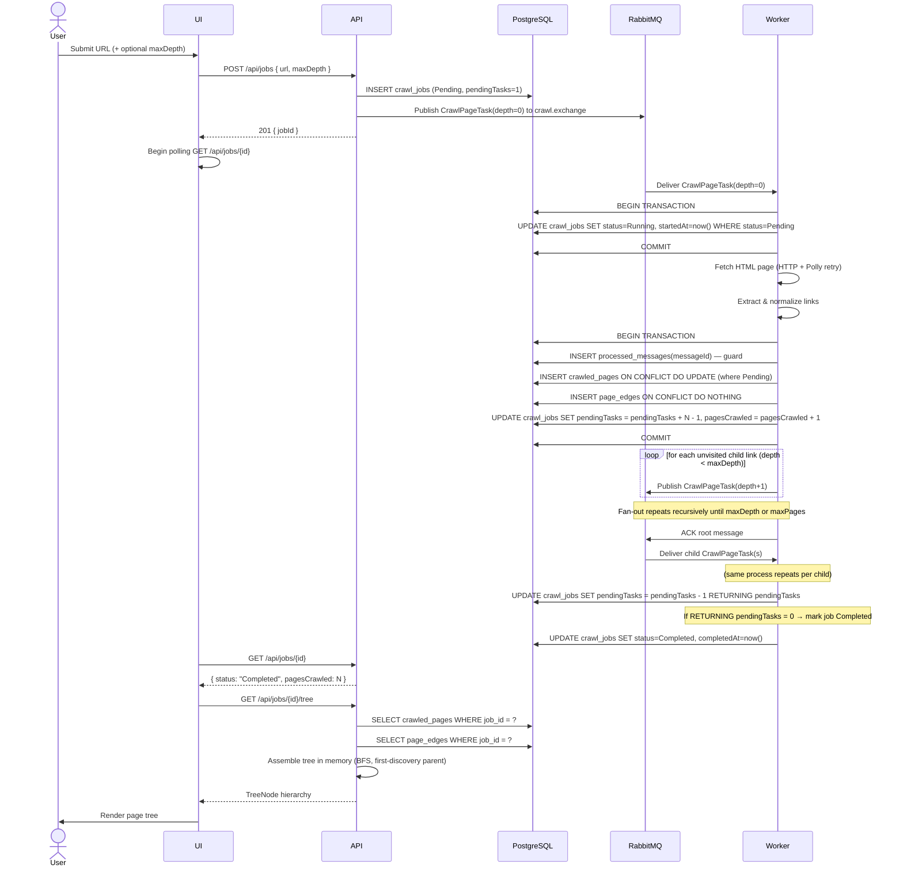
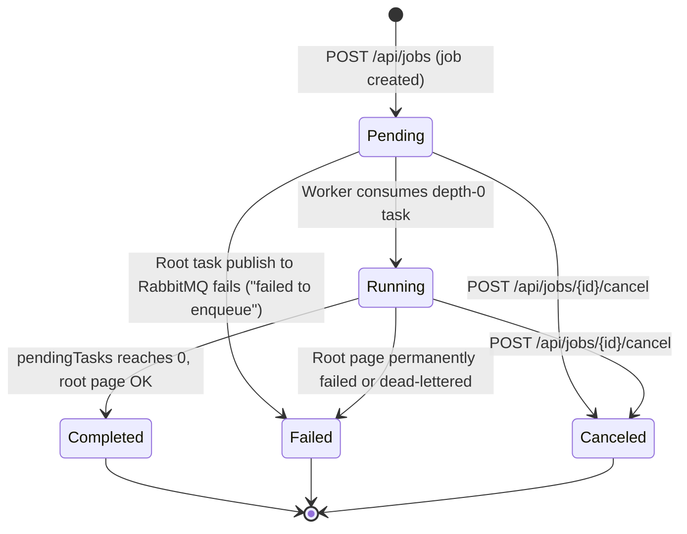
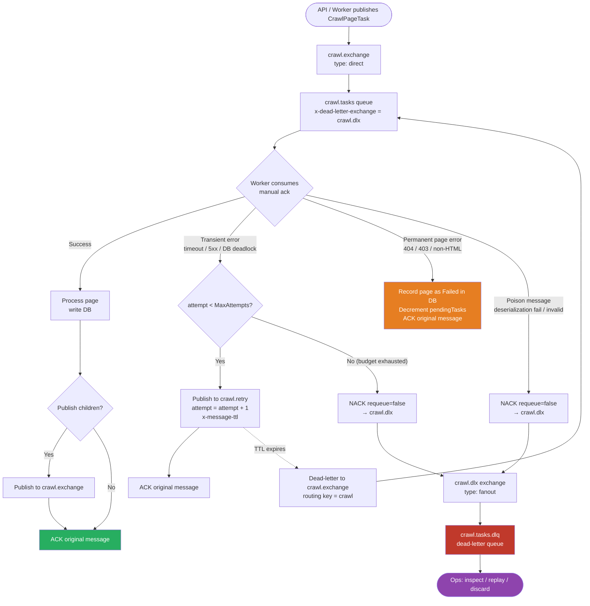
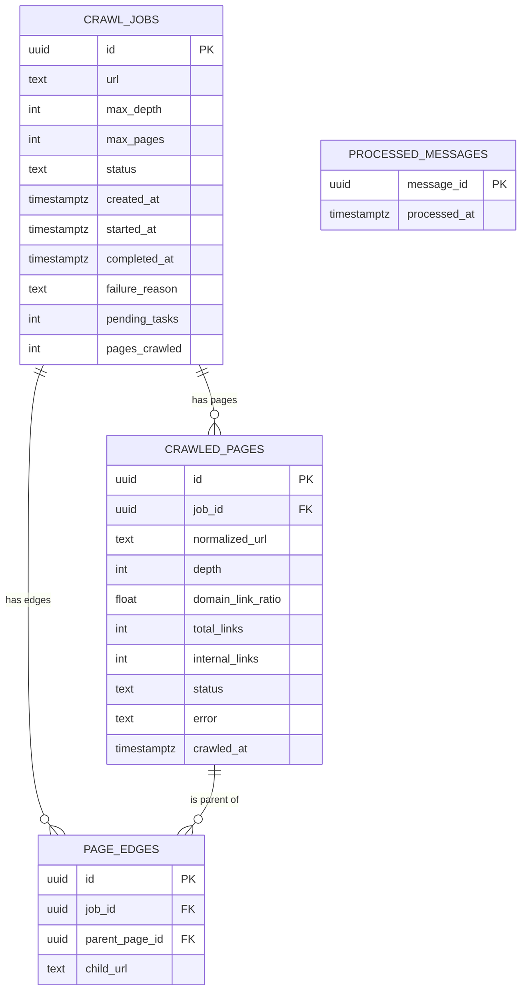

# System Flow — Web Crawler

> **Tag convention:** Every section is marked `[PLANNED]` until the corresponding phase ships and passes tests. Tags will be removed incrementally as phases complete.

---

## Purpose

This document describes the **runtime behaviour** of the web-crawler system: how a crawl job moves from submission to completion, how messages flow through the broker, how failures are handled, and what the data model looks like. It is the single reference for anyone reasoning about the system's moving parts.

---

## Actors

| Actor | Technology | Role |
|---|---|---|
| **UI** | React 18 + TypeScript + Vite (port 5173) | Submits URLs, polls job status, lists job history, renders the crawled-page tree |
| **API** | ASP.NET Core Web API (port 5000) | Validates input, creates jobs, publishes root task, serves status and tree |
| **Worker** | .NET Generic Host + BackgroundService (health port 5001) | Consumes crawl tasks, fetches pages, extracts links, fans out child tasks |
| **RabbitMQ** | RabbitMQ 3 (port 5672 / mgmt 15672) | Message broker: task queue, retry queue, dead-letter queue |
| **PostgreSQL** | PostgreSQL 16 (port 5432) | Persistent store for jobs, pages, edges, processed-message log |

---

## Happy Path



---

## Job State Machine



**Transition rules:**
- `Pending → Failed`: triggered immediately in `JobService.CreateJobAsync` if publishing the root `CrawlPageTask` to RabbitMQ fails after the DB transaction commits (`failureReason = "failed to enqueue"`).
- `Pending → Running`: triggered by the first consumed message; worker sets `startedAt` atomically only if current status is `Pending` (prevents races with duplicate delivery).
- `Running → Completed / Failed`: triggered by the worker when `pendingTasks` reaches 0 (or when the depth-0 root page fails permanently / is dead-lettered).
- `Pending / Running → Canceled`: triggered by `POST /api/jobs/{id}/cancel` (sets `completedAt = now()`); subsequent worker messages for this job are ACKed and skipped. Attempting to cancel an already terminal job returns `409 Conflict`.

---

## Message Lifecycle



**Queue topology:**

| Queue | Exchange / Entry | Routing Key | Arguments / Dead-Letter Configuration |
|---|---|---|---|
| `crawl.tasks` | `crawl.exchange` (direct) | `crawl` | `x-dead-letter-exchange = crawl.dlx` |
| `crawl.retry` | Default exchange (direct) | `crawl.retry` | `x-message-ttl = RetryDelayMs`<br>`x-dead-letter-exchange = crawl.exchange`<br>`x-dead-letter-routing-key = crawl` |
| `crawl.tasks.dlq` | `crawl.dlx` (fanout) | `""` (all) | Durable queue, unrouted/dead-letter storage |

---

## Idempotency Walkthrough

> **Goal:** a message delivered twice must have exactly the same visible effect as a message delivered once.

**Step-by-step (implemented in `CrawlTaskProcessor`):**

1. **Guard insert (inside main write transaction):** `INSERT INTO processed_messages (message_id, processed_at) VALUES (@id, now()) ON CONFLICT DO NOTHING`; check rows-affected.
   - If `0` rows affected → message already processed → `ROLLBACK`, `ACK` and return `Success` immediately without any side effects.
2. **Transition to Running** (prior atomic transaction): `UPDATE crawl_jobs SET status='Running', started_at=now() WHERE id=@jobId AND status='Pending'`.
3. **Page upsert:** `INSERT INTO crawled_pages (...) ON CONFLICT (job_id, normalized_url) DO NOTHING RETURNING id` → capture `insertedId` and determine `isNewPage`.
4. **Edge upserts:** `INSERT INTO page_edges (...) ON CONFLICT (job_id, parent_page_id, child_url) DO NOTHING` for parent-to-page and page-to-children.
5. **Child pages:** `INSERT INTO crawled_pages (...) ON CONFLICT (job_id, normalized_url) DO NOTHING RETURNING id` for eligible child URLs within `MaxPages` cap; capture newly inserted URLs for fan-out.
6. **Counter update:** atomically adjust `pending_tasks` by `newlyInserted.Count - 1` and increment `pages_crawled` by `1` (if `isNewPage`) via `UPDATE ... RETURNING pending_tasks`.
7. **Completion check:** if `pending_tasks <= 0`, set `status='Completed'` (or `'Failed'` if root page failed permanently) and `completed_at=now()`.
8. **Commit transaction.**
9. **Child fan-out:** publish `CrawlPageTask` messages for newly inserted child URLs only.
10. **ACK** original message.

**Why this order matters:** the `ProcessedMessages` guard at step 1 is the only thing that prevents step 6 (counter decrement) from running twice on duplicate delivery. Without it, a redelivered message would decrement `pending_tasks` a second time and trigger a premature job completion.

---

## Completion Detection Walkthrough

> **Invariant:** `pending_tasks` equals the number of `CrawlPageTask` messages in-flight or not yet consumed at any given moment.

| Event | `pending_tasks` delta |
|---|---|
| API creates job and publishes root task | +1 (set to 1 on job creation) |
| Worker publishes N child tasks | +N (in same transaction) |
| Worker finishes one task (success or permanent failure) | −1 |
| Worker sends task to DLQ (poison / exhausted) | −1 |

**Detection:**
```sql
UPDATE crawl_jobs
SET pending_tasks = pending_tasks + @delta,
    pages_crawled = pages_crawled + @pagesDelta
WHERE id = @jobId
RETURNING pending_tasks;
```
If `RETURNING pending_tasks <= 0` → mark job as `Completed` (or `Failed` with reason if the root page failed permanently) and set `completed_at = now()`.

**Dual-Write Window & Crash Semantics (D-009):**
The DB commit (step 8) and the broker publish (step 9) are separate operations.
- If worker crashes before commit: DB transaction rolls back; message is not acked; RabbitMQ redelivers task. Nothing was committed so redelivery safely re-processes.
- If worker crashes after commit but before broker publish: `pending_tasks` was incremented by N, but child messages were never published to RabbitMQ. The job will stall with `pending_tasks > 0`. This is the documented dual-write limitation (D-009). The **Transactional Outbox** pattern is the planned production enhancement.
- If worker crashes after broker publish but before consumer ACK: RabbitMQ redelivers the message; consumer re-executes; `ProcessedMessages` guard in step 1 detects duplicate message ID, rolls back, and ACKs without side effects.

---

## Data Model



**Indexes:**

| Table | Index | Purpose |
|---|---|---|
| `crawled_pages` | `UNIQUE (job_id, normalized_url)` | Idempotent upsert + duplicate prevention |
| `page_edges` | `UNIQUE (job_id, parent_page_id, child_url)` | Idempotent edge upsert |
| `crawl_jobs` | `INDEX (created_at DESC)` | History pagination (newest first) |
| `crawled_pages` | `INDEX (job_id)` | Efficient tree queries |
| `page_edges` | `INDEX (job_id, parent_page_id)` | Efficient tree assembly |
| `page_edges` | `INDEX (parent_page_id)` | FK index for cascade / joins |

---

## Failure Paths

| Failure type | Examples | Worker action | Job outcome |
|---|---|---|---|
| **Transient** | HTTP timeout, 5xx, 429, network error, DB deadlock | Publish to `crawl.retry` with `attempt+1` (TTL delay, dead-letters back to `crawl.tasks`); ACK original message | Job continues; task retried up to `MaxAttempts` |
| **Permanent (page-level)** | HTTP 404, 403, non-HTML content-type, URL rejected by normalizer | Record `CrawledPage` with `status=Failed` + error message; decrement `pending_tasks`; ACK | Job continues; that page marked failed |
| **Root page permanent failure** | Depth-0 task receives 404 / 403 / parse error | Same as permanent page-level, but also set `crawl_jobs.status=Failed`, `failure_reason=...` | Job marked `Failed` |
| **Dead-letter: retries exhausted** | Attempt ≥ MaxAttempts on transient error | `OnDeadLetteredAsync`: record page as `Failed`, decrement `pending_tasks`, finalize job if 0. Commit DB, then `NACK requeue=false` → `crawl.tasks.dlq` (D-018) | Counter accurate; job completes or fails; task in DLQ for ops inspection |
| **Dead-letter: poison task** | Valid JSON schema but logically poison result | Same as retries exhausted (`OnDeadLetteredAsync` commits DB first, then `NACK requeue=false` → DLQ) | Counter accurate; page marked Failed; task in DLQ |
| **Dead-letter: deserialization failure** | Corrupted JSON or unparseable payload | No `jobId` available; log error and `NACK requeue=false` → DLQ immediately without DB finalization | Message routed to DLQ; ops inspection required |
| **Dead-letter finalization DB failure** | Database unreachable during `OnDeadLetteredAsync` | Do NOT nack; republish to `crawl.retry` with unchanged `Attempt` and ACK original | Task preserved; redelivered once DB recovers to finalize cleanly |
| **Worker crash mid-processing** | Crash after DB commit, before ACK | Broker redelivers; `ProcessedMessages` guard prevents double-processing; ACK on redelivery | No corruption; task processed exactly once |
| **Worker crash after publish, before ACK** | Crash after child tasks published but before ACKing parent | Broker redelivers parent; `ProcessedMessages` guard fires; child tasks may be duplicated in broker | Child tasks processed idempotently via `ON CONFLICT DO NOTHING` on page/edge inserts; `pending_tasks` counter may be over-incremented if dual-write guard is not in place (known limitation — D-009) |
| **Worker crash after dead-letter commit, before NACK** | Crash after `OnDeadLetteredAsync` commits DB transaction, before `BasicNack(requeue=false)` is sent | Broker redelivers task. Redelivery triggers dead-letter path; `TryInsertProcessedMessageAsync` guard detects duplicate `messageId` and skips DB writes without double-decrementing `pending_tasks`; consumer then sends `BasicNack(requeue=false)` to move message to DLQ | Counter accurate; page marked Failed; message lands in DLQ |
| **Dual-write failure** | DB commit succeeds; broker publish fails for child tasks | `pending_tasks` inflated; job stalls | Known limitation (D-009); manual recovery needed |
| **Job canceled mid-crawl** | `POST /api/jobs/{id}/cancel` called | Worker checks job status at task start; if `Canceled`, ACK and skip processing | Job status set to `Canceled`; in-flight tasks discarded cleanly |

---

## Frontend

The React 18 + TypeScript single-page application in `/frontend` communicates with `Crawler.Api` over `/api` (proxied to `http://127.0.0.1:5000` by Vite in development, or to `http://api:5000` by nginx when started via `docker compose --profile frontend up`):

- **`/` (`StartCrawlPage`)**: Validates an absolute `http://` or `https://` URL and optional `maxDepth` (`0..5`, default `2`), submits `POST /api/jobs`, navigates to `/jobs/:jobId` on `201 Created`, or displays a dismissible `ProblemDetails` error banner on failure.
- **`/jobs/:jobId` (`JobDetailsPage`)**: Polls `GET /api/jobs/:id` every 2 seconds via `useJob` while `status` is `Pending` or `Running` (showing an indeterminate progress bar, live `pagesCrawled` and `pendingTasks` counters, and a subtle `"Updating..."` indicator during refetches), and stops polling once `status` reaches `Completed`, `Failed`, or `Canceled`. In any terminal state, `useJobTree` requests `GET /api/jobs/:id/tree` (mapping `404` to a neutral empty state) and renders `SummaryCards` plus the recursive WAI-ARIA `PageTree` (root expanded, depth > 1 collapsed by default, URL substring filter, expand/collapse all, keyboard navigation, and color-coded Domain Link Ratio bars).
- **`/history` (`HistoryPage`)**: Fetches paginated `GET /api/jobs?page=X&pageSize=Y` (`10`, `20`, or `50` per page) using `placeholderData: keepPreviousData`, rendering newest jobs first with row-click navigation to `/jobs/:jobId`.


